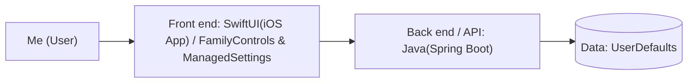

# LockIn Mobile Application

# LockIn App

> One line: Distraction is right in the palm of our hands, and it's our own phones.
> 

**Author:** [Alexa Montilla] · **Course:** CMP 464/343 Product 1 · **Last updated:** [10/21/2026]

---

## 1. About Me (the User)

*I am a full-time college student and work as a part-time STEM instructor for an after-school program.*

**Real, recent moments for what went wrong, what it cost, and what did i do**

1. Home, kitchen table as a study table (no dedicated study space, close to the living room). Reviewing math notes, a 10-15 minute break became an hour, cutting into time for other coursework.
2. Tuesdays, the longest work day with barely any breaks. Starts studying tired, uses the phone as relief, and the distraction spirals. No missed deadlines, but loses organization time and ends up cramming at minute, which turns studying into a hardship.

**What it costs me:**

- ⏱️ Time:  A simple 10-15 minute break sometimes extends to an hour or so, maybe on 3-4 a day a week when I am studying something important. It is roughly 3-4 hours of lost study time
- 💸 Money: N/A
- 🔋 Energy: My energy is low on my longest work days, and break doesn’t restore me, it leaves me a bit more drained. I’m basically doing the hard coursework on my lowest energy.
- 🙂 Joy: I end my studying sessions stressed and feeling worse than before the break, studying becomes a hardship sometimes instead of manageable work.

---

## 2. Problem Statement

**Gut check:**

> I need a way to take bounded breaks while studying hard courses such as my math courses, because a 10 minute break regularly turns into an hour on 3-4 days a week. This is worst at my kitchen table, my only study space, and when I start tired after long work days. My phone is the source of the distraction, not any single app, my blocker covers some apps but I switch to others. I end up stressed, behind on coursework, and feeling worse than before the break.
> 

**Five Whys:**

1. Why? Needed to refresh my mind after a long day of work and school. 
2. Why? My phone is the only way to distract myself from stress.
3. Why? Feeling tired to start hard work at home, since getting through work and school already took effort. 
4. Why? Because picking up my phone is easier than going straight to studying/homework
5. Why? Another way to avoid responsibilities and I already feel drained. 

**Problem statement:**

> 
> 
> 
> When I sit down to study hard courses like math, especially at my kitchen table or after a long day of work and school, I struggle to keep my 10-15 minute break bounded, it regularly stretches into an hour. Which costs me roughly 3-4 hours of lost study time a week, plus energy, since I'm already drained from work and the break doesn't restore me, and joy, since I end sessions stressed and feeling worse than before. This happens because I don't have another way to unwind from stress or ease into hard work, so my phone fills that role by default, even though picking it up is also a way of avoiding the work in front of me. Right now I use an app blocker that limits certain apps, but once the limit hits I switch to others like YouTube, so the break runs long.
> 

**I'll know this is solved when:** I limit my phone usage to keep my study breaks consistently close to their planned length. Meaning, no more jumping from Instagram to YouTube once when time runs out. 

---

## 3. Existing Solutions

| What I use or tried | What it does well | Why it falls short *for me* |
| --- | --- | --- |
| App blocker | Blocks distracting apps  | Costs money and you switch to an unblocked app once the 15 minutes end |
| Grayscale Screen | It decreases screen time  | Genuinely reduces scrolling, but has to be turned off for documents/images, and once color's back on, nothing stops the scroll |
| Leaving phone in another room | Phone not next to me all the time while studying | It removes the friction. not the choice, still easy to go get it |
| Library | Environment is quiet and free from distractions | Works well when I’m there, but travel time and schedule limit it to about 2 days a week |
|  |  |  |

**The gap:** 

Nothing intervenes at the actual moment a break should end, so every fix depends on willpower I don't reliably have on my hardest, most drained days.

---

## 4. Features & Benefits

| Feature (what it does) | Benefit (how my life gets better) | MVP or Later? |
| --- | --- | --- |
| Blocks ALL apps and websites with no limits | Staying focus and recovered study time. | MVP |
| Locks whole phone  | removes access to addictive apps entirely, no switching possible. | Later |
| Time block | Breaks are still possible, but there's no app to fall that makes it longer | MVP |
| Color mode changer | Brings down dopamine triggers and makes scrolling boring | MVP |
|  |  |  |

## **MVP (2–3 features):** *The skateboard: the smallest version I'd actually use.*

- App blocker to block off app that causes a distraction.
- A Timer. How many hours a day the phone will be blocked

## **Later: Lock the whole phone beside phones and messages**

## **Not doing:** Color mode changer

---

## 5. Tech Stack

### Front end

- **Surface:** Mobile
- **Tools:** Xcode(Swift), Java
- **Why:** The phone is where you spend the most time and where the distraction actually happens, so the fix needs to live there, not on a device you're not already holding

### Back end

| Piece | Choice | Why |
| --- | --- | --- |
| Server / API | Spring Boot (Java) | To provide a clear and structured API that pairs cleanly w/ iOS users |
| Data storage | Undecided |  |
| Outside services (optional) | Apple's native framework (FamilyControls & ManagedSettings) | This lands directly on iOS user side for system restrictions |
| Hosting / deploy | Undecided |  |

### Architecture sketch

---

## 6. Open Questions

*What am I still unsure about? What do I need to figure out or test first?*

- Figure out if I should block the the whole phone(expect phone calls/messages)?
